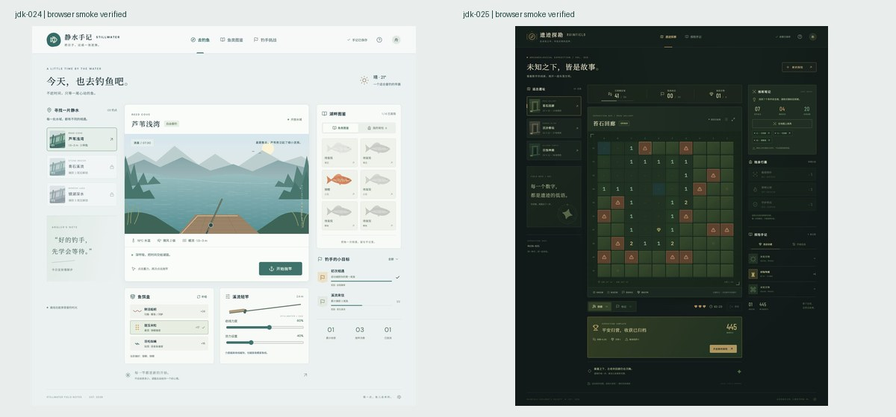

# origin-project 项目与候选题复核

2026-11-22。按新版 game-media-frontend-prompts 技能完成 jdk-024、jdk-025 的源码、题面、运行与独立语义复核。用户确认两套题均未被平台作废，因此允许调整现有候选；各保留 12 条代码生成和 12 条 Feature，不新增 Bug。

**本地独立 P5 审查：48/48 通过。P6：48/48 待完整解题实跑。** 这是候选题复核结论，不能当作平台预先批准或 P6 实测达标。

| 项目 | 题数 | 实质改写 | 保留原文 | 基线代码调整 |
| --- | ---: | ---: | ---: | --- |
| jdk-024 静水手记 | 24 | 21 | 3 | 修复损坏或不可读存档被自动覆盖的问题，涉及 storage.ts、useGame.ts |
| jdk-025 遗迹探勘 | 24 | 18 | 6 | 无需修改源码 |

## 可直接查看的产物

- [jdk-024 提示词](../origin-project/jdk-024/jdk-024_提示词_1120.md)
- [jdk-025 提示词](../origin-project/jdk-025/jdk-025_提示词_1120.md)
- [jdk-024 独立复核](jdk-024/independent-review.md) · [完整验收记录](jdk-024/acceptance.json)
- [jdk-025 独立复核](jdk-025/independent-review.md) · [完整验收记录](jdk-025/acceptance.json)

每个验收目录另含原稿备份 original-20261122、作者逐题证据 tasks.json、原题判断 prompt-review.md、容量复核 capacity.md、运行日志 logs、截图 screenshots。验收材料位于项目外，不应作为题目初始仓库的一部分导入。

## 本轮消除的薄弱点

按源码扣除了基线已有的时钟、种子、集中命令、公开视图、存档与结算能力。先让独立复核者尝试最简单的完整方案，再对照作者证据；只加暂停、重复提交保护或多面板联动，不单独计为 H3。

独立首审继续发现五处常规方案足够的候选，均实质改题后重审：

| 题目 | 被否定的难度依据 | 最终用户目标 |
| --- | --- | --- |
| jdk-024 gen-02 | 小步离线模拟已可满足原赛事快进 | 隐藏对手类型、只使用届时公开信息的保证晋级策略 |
| jdk-024 gen-05 | 固定统计摘要已可保留原回放认证信息 | 在操作次数、间隔和锁定片段限制下求最晚可救接管点 |
| jdk-024 gen-07 | 同一更新函数离线重放已可完成六小时补算 | 空间、预算和锁定约束下，全程健康的最少调整修复方案 |
| jdk-024 feature-12 | 常规前缀等待与阶段合法表已可识别原手势 | 有一次漏点或多点时仍防误触、同时满足时限的手势方案生成 |
| jdk-025 feature-09 | 带方向和剩余射程的遍历已可覆盖原传送门规则 | 共享门影响多条光路时，联合寻找满足目标与禁照区的最少改动 |

各题还核对了 H1 的题面原句、H2 的实际数据流、H3 的剩余决策与反例，以及少于五个业务文件的替代方案。复核中纠正了把可复用的物理、揭格、道具函数强称必改的证据；最终必要职责由独立复核者确认。220 处源码引句均与最终源码一致。所有未来功能仍是待实现题目，未提前放入基线。

## 项目验证

两个项目均为 React + TypeScript + Vite 纯前端，各有五个模块，分别为 39、41 个业务文件。两套均通过类型检查、生产构建、结构检查、Docker 配置、镜像构建、容器启动与 HTTP/静态资源/回退路由验证。

浏览器每套验证三条真实交互链，覆盖各自全部五个模块：

- jdk-024：选饵、出竿与扣料；搏鱼上岸后背包、图鉴和挑战联动；领奖、放流、刷新后历史与数量保持。实际捕获锦鲤 2.67kg，放流后图鉴仍保留，奖励不重复领取。
- jdk-025：首步安全展开及推断；探针扣料与可靠情报进入推断；暂停、撤离和刷新后归档与积分不重复。实际撤离为 41/86 格、1 件文物、445 分，刷新后保持同一份归档。

两套页面的控制台 error 记录为空。测试专用 Docker 容器已清理。第一次定位失败和钓鱼松线超时也如实保留在浏览器日志，没有伪装成产品成功操作。

jdk-024 存档修复通过真实 useGame effect 的回归验证：损坏 JSON、未知版本、字段错误和读取异常均不再自动写回覆盖；有效存档和新玩家继续正常保存，写入失败保留原内容。参见 [修复说明](jdk-024/storage-repair.md)、[实际 diff](jdk-024/storage-fix.diff) 和前后运行日志。

## 校验范围与待办

本次保留用户指定的 12+12。格式检查复用技能原解析器，在本次检查进程中调整类别数量；另验证题面引句、源码引句、增改路径、正常/边界场景和独立报告一致性。没有把默认 22 题的 check-delivery 全量检查声称为这两套通过证据。最终指纹由技能原命令取得，并与独立复核报告逐一比对。

P6 所需的每题完整解题轨迹尚不存在；所有条目均为 estimated、estimate=null、runs=[]。本轮审题、项目构建和冒烟测试的工具调用不计作解题调用。后续须从各自同一冻结基线逐题独立实跑，核验真实有效调用数、排除项与完成结果，才能将整套由候选转为全部验收通过。

源码或题面后续变化时，需要重新核对受影响证据与哈希，不能沿用本轮结论。
